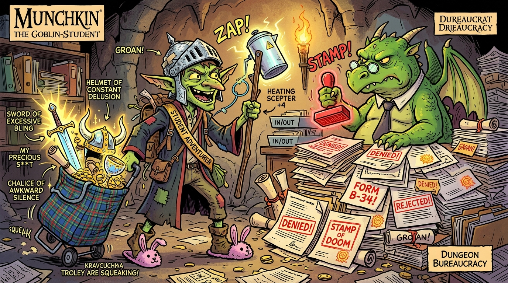

# 🗂️ ХАПУГИ: Підземелля Бюрократії (Munchkin Parody Game)

> Авторська українська сатирична версія культової карткової гри **Munchkin**.



## 📌 Про проект

**«ХАПУГИ»** — це картковий roguelite-баттлер для 2–6 гравців, натхненний правилами Munchkin та естетикою абсурдної української бюрократії, гуртожитків, ринків та нескінченних кабінетів ЖЕКу.

### 🎮 Основні правила та фішки
1. **Мета:** Прокачатися з 1-го до 10-го рівня та стати Головним Начальником. 10-й рівень береться тільки перемогою над Монстром!
2. **Дві колоди:**
   - 🚪 **«Двері Кабінету»:** Монстри (Сисадмін, Вахтерка, Дракон-Бюрократ), Прокльони («Обідня перерва») та Класи («Студент», «Базарник»).
   - 💰 **«Хабар та Лут»:** Шмотки (Кип'ятильник люті, Кравчучка жадібності, Шапка з фольги) та Одноразові підгони (Банка огірків, Цукерки «Вечірній Київ»).
3. **Соціальна динаміка:**
   - Можливість кликати інших на допомогу в обмін на скарби.
   - Підсилення монстрів картками-підставами («Без черги!», «Скажений»).
   - Змивання на кубику d6 (успіх на 5 або 6).

---

## 📁 Структура папки
```text
munchkin-game/
├── assets/
│   └── concept_art.jpg      # Головний візуальний концепт-арт
├── docs/
│   └── GAME_DESIGN.md       # Повний дізайн-документ (GDD, баланс, механіки)
├── src/
│   └── cards_db.json        # База даних перших карт (Монстри, Шмотки, Прокльони)
└── README.md                # Цей файл опису проекту
```

---

## 🚀 Наступні кроки розробки
- [ ] Створення прототипу механіки бою на TypeScript/React.
- [ ] Генерація повного набору ілюстрацій для карт першого сету (30 Дверей + 30 Скарбів).
- [ ] Оформлення інтерактивного UI під Telegram Mini App (підтримка мобільних екранів без скролу).
- [ ] Мережевий лобі-сервер для гри з друзями в Telegram.
