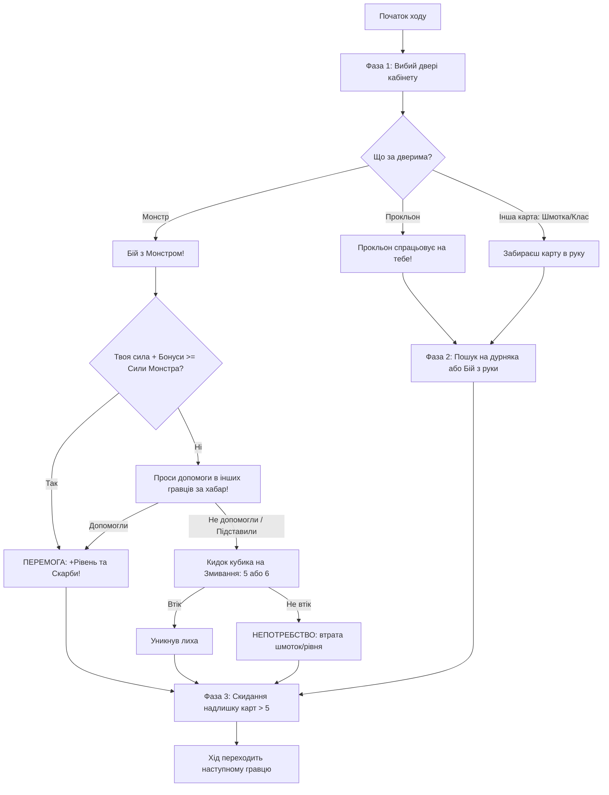

# ХАПУГИ: Підземелля Бюрократії (Khapugy: Dungeon Bureaucracy)
> *«Вибий двері кабінету, намани хабар, підстав кума, дійди до 10-го рівня!»*

Власна авторська сатирична карткова гра за мотивами культового **Munchkin**, переосмислена в унікальному українському комедійному сеттингу: симбіоз абсурдної пострадянської бюрократії, легендарних стихійних ринків 90-2000-х, студентського гуртожитку та міського фентезі.

---

## 1. Концепція та Лор гри

### 🏛️ Світ «Великого ЖЕКу»
Дія гри розгортається у нескінченному лабіринті нескінченних коридорів **«Головного Управління Всього на Світі»**. Це містичне підземелля, де:
- Двері — це оббиті потертим дерматином кабінети з табличками «Перерва 15 хвилин» (яка триває вічність).
- Монстри — це грізні істоти бюрократичного та побутового пантеону: від **«Лютої Кондукторки»** до **«Дракона-Чиновника з Печаткою Відмови»**.
- Скарби — це не банальні золоті мечі, а артефакти на кшталт **«Кип'ятильника Люті +3»**, **«Картчатої Кравчучки Жадібності»** чи **«Довідки про те, що тобі потрібна довідка»**.

### 🎯 Мета гри
Кожен гравець починає звичайним **«Здобувачем Довідки 1-го рівня»** без класу та регалій.
- Мета: першим досягти **10-го Рівня** («Головний Начальник / Володар Золотої Печатки»).
- Переможний 10-й рівень можна здобути **виключно вбивством Монстра** (як у класичному Манчкіні).

---

## 2. Візуальний стиль

- **Стилістика:** Коміксний гротеск, сатиричний малюнок тушшю з соковитими насиченими кольорами (поєднання естетики класичного Munchkin Джона Коваліка з деталізованою анімацією сучасної інди-гри).
- **Персонажі:** Гобліноподібні студенти у шльопанцях-зайчиках та каструлях замість лицарських шоломів, бабусі-чарівниці з торбами на колесах, кібер-козаки з подовжувачами замість шабель, коти-рекетири.
- **Інтерфейс карт:**
  - Верхній банер: Назва карти жирним коміксним шрифтом.
  - Центральний арт: Деталізована гумористична ілюстрація зі звуковими написами (ZAP!, STAMP!, ГРРР!).
  - Нижній блок: Чіткі цифрові показники бойової сили (+2, Рівень 8), вимоги до класу та кумедний художній опис (флейвор-текст).

---

## 3. Дві Колоди Гри

Гра використовує дві окремі колоди карт з унікальними сорочками:

### 🚪 Колода 1: «ДВЕРІ КАБІНЕТУ»
Карти, з якими гравець стикається, вибиваючи чергові двері кабінету:
1. **Монстри (Monsters):**
   - *Сисадмін на Обіді* (Рівень 2, Непотребство: вимикає роутер — скинь карту з руки).
   - *Зла Вахтерка Гуртожитку* (Рівень 6, +3 проти Студентів, Непотребство: не пускає ночувати — втрачаєш 1 хід).
   - *Голуб-Колектор* (Рівень 1, легка здобич, скидає 1 скарб).
   - *Пліснявий Борщ у загальному холодильнику* (Рівень 8, токсична атака, знищує твій захисний одяг).
   - *Дракон-Бюрократ* (Рівень 16, 2 скарби, 2 рівні за перемогу. Ставить печатку «ВІДМОВЛЕНО» на все твоє спорядження).
2. **Підсилювачі Монстрів (Modifiers):**
   - *«Без Черги»* (+5 до сили монстра).
   - *«Скажений / Не виспався»* (+10 до сили монстра, дає +1 додатковий скарб).
   - *«Кум Начальника»* (Монстр автоматично б'є найсильнішого гравця).
3. **Прокльони (Curses / Підстави):**
   - *«Обідня перерва з 13:00 до 15:00»* — гравець не може використовувати зброю в цьому бою.
   - *«Загублена трудова книжка»* — втрата 1 рівня.
   - *«Раптовий податок на розкіш»* — скинь найдорожчу шмотку.
4. **Професії та Соціальні Статуси (Класи та Раси):**
   - **Студент-Бюджетник:** Бонус до змивання (+1 на кубику), вміє варити кашу з сокири (тягне зайву карту, коли голодний).
   - **Базарний Торгаш:** Може носити дві великі шмотки, вміє продавати непотріб іншим гравцям дорожче.
   - **Айтівець на галері:** Може «донатити» карти з руки для збільшення бойової сили в бою.
   - **Кум Самого Начальника:** Може раз за коло відмінити прокльон або взяти хабар.

### 💰 Колода 2: «ХАБАР ТА ЛУТ» (Скарби)
Карти спорядження та одноразових бонусів:
1. **Шмотки (Equipment):**
   - **Шолом:** *Шапка з фольги від 5G* (+2 захист від прокльонів).
   - **Броня:** *Спортивка «Abibas» 90-х* (+1 до авторитету).
   - **Взуття:** *Шльопанці-Зайчики Швидкості* (+2 до втечі).
   - **Зброя (1 рука):** *Кип'ятильник Люті* (+3 до бойової сили, ураження струмом).
   - **Зброя (2 руки):** *Дворучна Кравчучка Жадібності* (+4 до сили, дозволяє нести необмежену кількість дрібних шмоток).
2. **Одноразові підгони (Consumables):**
   - *Коробочка «Вечірній Київ»* — підкупи монстра до 5-го рівня без бою (забираєш скарби, але не рівень).
   - *Банка бабусиних огірків* — дає +5 у будь-якому бою одному з учасників.
   - *Флешка з компроматом* — змушує іншого гравця допомогти безкоштовно.

---

## 4. Структура ігрового ходу

---

## 5. Цифрова архітектура (Web / Telegram Mini App)

1. **State Machine (XState / Redux pattern):**
   - Чіткі фази ходу: `DOOR_KICK`, `COMBAT`, `HELP_OFFER`, `RUN_AWAY`, `CHARITY`.
   - Одночасне голосування та підкидання карт іншими гравцями за таймером (наприклад, 10 секунд на реакцію).
2. **Multiplayer Engine:**
   - Вебсокети (Socket.io) або Peer-to-Peer для кімнат на 2–6 гравців.
   - Синхронізація колод, бойової сили та руки кожного гравця.
3. **Telegram Mini App адаптація:**
   - Оптимізація під один мобільний екран:
     - Верхній сектор: Супротивники та їхні поточні рівні/шмотки.
     - Центральний сектор: Кабінет (активний бій, показник сили Гравця проти Монстра).
     - Нижній сектор: Рука карт з горизонтальним скролом та таб «Моє Спорядження» (Одягнені шмотки).
   - Кнопка швидкого запиту: «Кум, допоможи!» з вибором відсотка скарбів.
