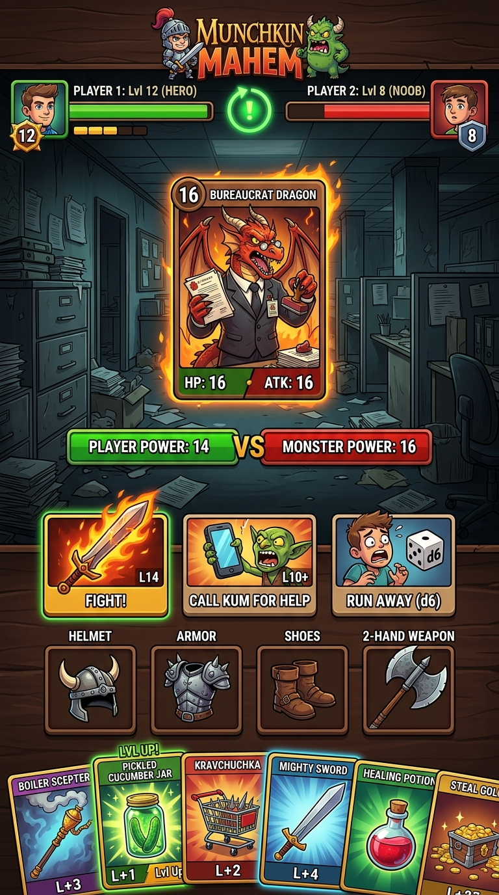

# 📱 Концепт ігрового екрана: «ХАПУГИ: Підземелля Бюрократії»

## 📐 Зонування мобільного екрана (100% Zero-Scroll)

1. **Верхній сектор (Гравці та Лобі):**
   - Аватарки суперників (кумів), їхні рівні від 1 до 10 та статус готовності.
   - Круговий анімований індикатор активного ходу.

2. **Центральна бойова арена (Кабінет ЖЕКу):**
   - Велика ілюстрована карта активного Монстра (наприклад, Дракон-Бюрократ з печаткою «ВІДМОВЛЕНО»).
   - Великі плашки порівняння сил: `ТВОЯ СИЛА: 14` проти `СИЛА МОНСТРА: 16`.
   - Зелена підсвітка — перемога, червона — загроза непотребства.

3. **Блок оперативних рішень (3 головні кнопки під пальцем):**
   - ⚔️ **«ВБИТИ!» (Fight):** Нанести фінальний удар, якщо сила дозволяє.
   - 📱 **«КЛИКАТИ КУМА» (Call Kum):** Запит допомоги в інших гравців за частку скарбів.
   - 🎲 **«ЗМИВАТИСЯ (d6)» (Run Away):** Анімований кидок кубика для втечі.

4. **Панель одягненого спорядження (Інвентар):**
   - 4 слоти: `[Шолом]` • `[Броня]` • `[Взуття]` • `[Зброя 1-2 руки]`.
   - Наочні іконки та показники бойового бонусу.

5. **Рука гравця (Карткова стрічка):**
   - Горизонтальний плавний скрол карток без виходу за межі екрана.
   - Швидкий таб: одягти шмотку або застосувати разовий підгон (банку огірків, цукерки) прямо в бою.
